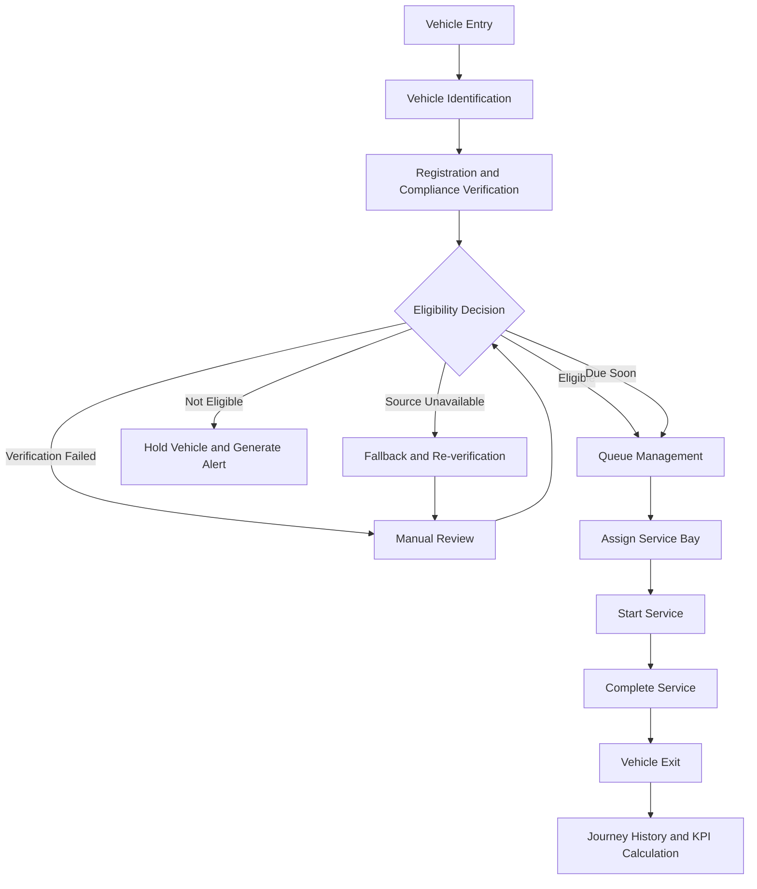
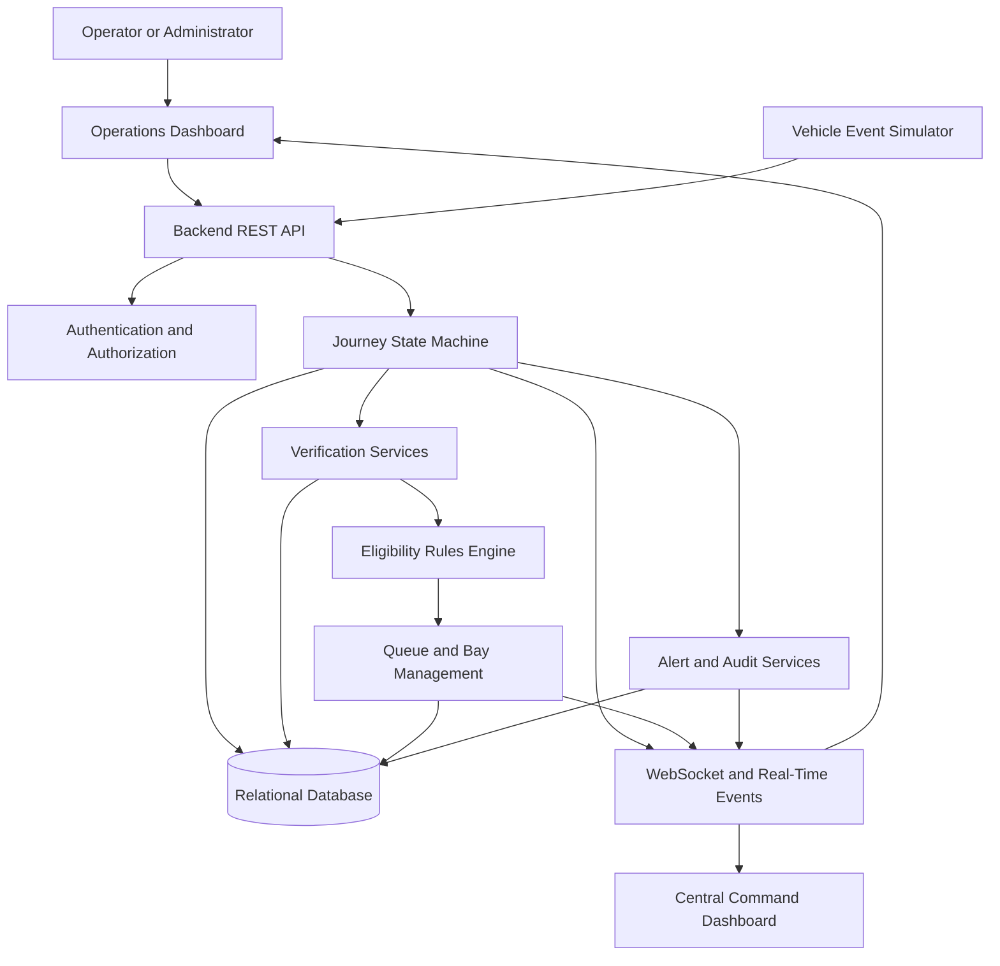

# Smart Vehicle Detection

## Smart Vehicle Compliance & Journey Management Platform

A full-stack vehicle operations platform designed to manage vehicle entry, identification, compliance verification, eligibility decisions, queue management, service bay allocation, alerts, and journey tracking.

The platform aims to provide a centralized system for monitoring vehicle movements, identifying compliance issues, and maintaining historical records of operational activities.

## Table of Contents

- Overview
- Problem Statement
- Key Features
- Vehicle Journey Workflow
- System Architecture
- Technology Stack
- Project Structure
- Getting Started
- Configuration
- API Documentation
- Security
- Testing
- Future Enhancements
- Author

## Overview

Smart Vehicle Detection is designed to digitize and streamline vehicle operations across multiple operational sites.

The system is intended to simulate vehicle identification through camera events, verify vehicle registration and compliance information, determine eligibility, and track each vehicle's journey from entry to exit.

It also provides a foundation for alerts, service bay management, audit logging, historical reporting, and centralized monitoring.

## Problem Statement

Traditional vehicle operations may depend on manual verification, disconnected systems, and limited visibility into queues, service resources, and compliance issues.

These challenges can lead to:

- Delays during vehicle entry and verification.
- Difficulty identifying non-compliant vehicles.
- Inefficient queue and service bay allocation.
- Limited visibility into ongoing vehicle journeys.
- Delayed detection of camera or external service failures.
- Incomplete operational history and audit records.

Smart Vehicle Detection aims to address these challenges through backend business logic, structured vehicle journeys, operational monitoring, and event tracking.

## Key Features

### 1. Vehicle Identification

- Simulate vehicle entry events from cameras or edge devices.
- Capture vehicle registration numbers and detection timestamps.
- Record identification confidence.
- Prevent duplicate detections from creating duplicate journeys.

### 2. Vehicle Verification

- Simulate vehicle registration and identity checks.
- Simulate vehicle certification and compliance checks.
- Record verification results and their sources.
- Handle invalid vehicles, expired certifications, timeouts, and unavailable services.

### 3. Eligibility Decision Engine

Evaluate verification results through backend business rules.

| Decision | Intended Behaviour |
|---|---|
| ELIGIBLE | Allow the vehicle to proceed |
| DUE SOON | Allow progression with a warning |
| NOT ELIGIBLE | Place the vehicle on hold and generate an alert |
| VERIFICATION FAILED | Require manual review |
| SOURCE UNAVAILABLE | Apply the configured fallback and flag re-verification |

### 4. Queue Management

- Maintain a queue for each site.
- Display queue position and waiting time.
- Prevent vehicles on hold from entering the normal queue.
- Update queue information as vehicle states change.

### 5. Service Bay Management

- Track bay availability and occupancy.
- Support AVAILABLE, RESERVED, OCCUPIED, BLOCKED, and MAINTENANCE states.
- Assign available bays to eligible vehicles.
- Record service start and completion.
- Release bays after service completion.
- Calculate resource utilisation.

### 6. Alerts and Monitoring

Potential operational alerts include:

- Non-eligible vehicles.
- Failed verification checks.
- External service outages.
- Camera disconnections.
- Excessive queue length or waiting time.
- Unavailable service resources.
- Unexpected system errors.

Alerts should support OPEN, ACKNOWLEDGED, and RESOLVED states.

### 7. Vehicle Journey Tracking

Maintain a chronological record of vehicle movement, including entry, identification, verification, eligibility, queue placement, bay assignment, service activity, and exit.

### 8. Multi-Site Command Centre

The platform is designed to support centralized monitoring of multiple sites, including vehicle activity, site availability, queue lengths, active alerts, turnaround time, and resource utilisation.

### 9. Authentication and Role-Based Access Control

The intended role model includes:

- **Operator:** Daily site operations and alerts.
- **Site Manager:** Site management and authorised overrides.
- **Regional Manager:** Multi-site monitoring and analytics.
- **Auditor:** Read-only access to historical records and reports.
- **Admin:** User, site, and system configuration management.

Permissions should be enforced by the backend, not only by hiding frontend controls.

### 10. Audit Trail

Record important operational actions with timestamps, user information, related vehicles, previous and new states, and reasons for authorised overrides.

## Vehicle Journey Workflow

The intended vehicle journey follows this sequence:

Entry → Identification → Verification → Eligibility Decision → Queue → Bay Assignment → Service → Completion → Exit

If verification fails or a vehicle is not eligible, the system should place it on hold and generate an alert for operator review.

### Workflow Diagram



## System Architecture

The intended architecture separates the user interface, backend business logic, persistent storage, and real-time event delivery.



Note: This diagram represents the intended logical architecture. Update it if the implemented architecture differs from this design.

## Technology Stack

The repository contains a Java-based backend structure and Maven project configuration. Confirm the exact dependencies in `pom.xml` before finalising this section.

| Component | Technology |
|---|---|
| Backend | Java |
| Backend Framework | Spring Boot, if configured |
| API Communication | REST APIs and JSON |
| Persistence | Jakarta Persistence / JPA |
| Database | Configured relational database |
| Build Tool | Maven |
| Real-Time Communication | WebSocket, if implemented |
| Authentication | Authentication and role-based access control |
| Version Control | Git and GitHub |

## Project Structure

The current repository includes a Maven project and a Java package under `com.abhinav.smartvehicledetection`.

```text
SmartVehicleDetection/
├── .mvn/
├── src/
│   └── main/
│       └── java/
│           └── com/
│               └── abhinav/
│                   └── smartvehicledetection/
│                       ├── config/
│                       ├── controller/
│                       ├── dto/
│                       ├── entity/
│                       └── ...
├── pom.xml
├── mvnw
├── mvnw.cmd
└── README.md
```

Additional packages and files may exist in the repository. Update this structure as the implementation develops.
