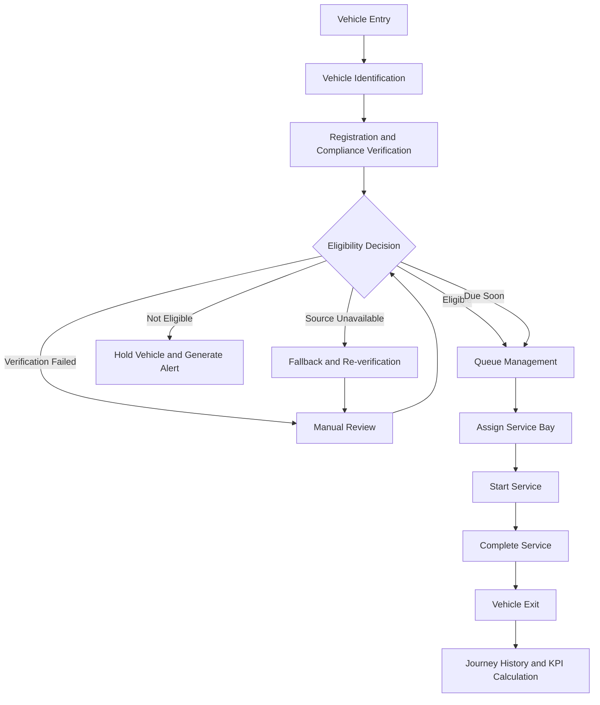
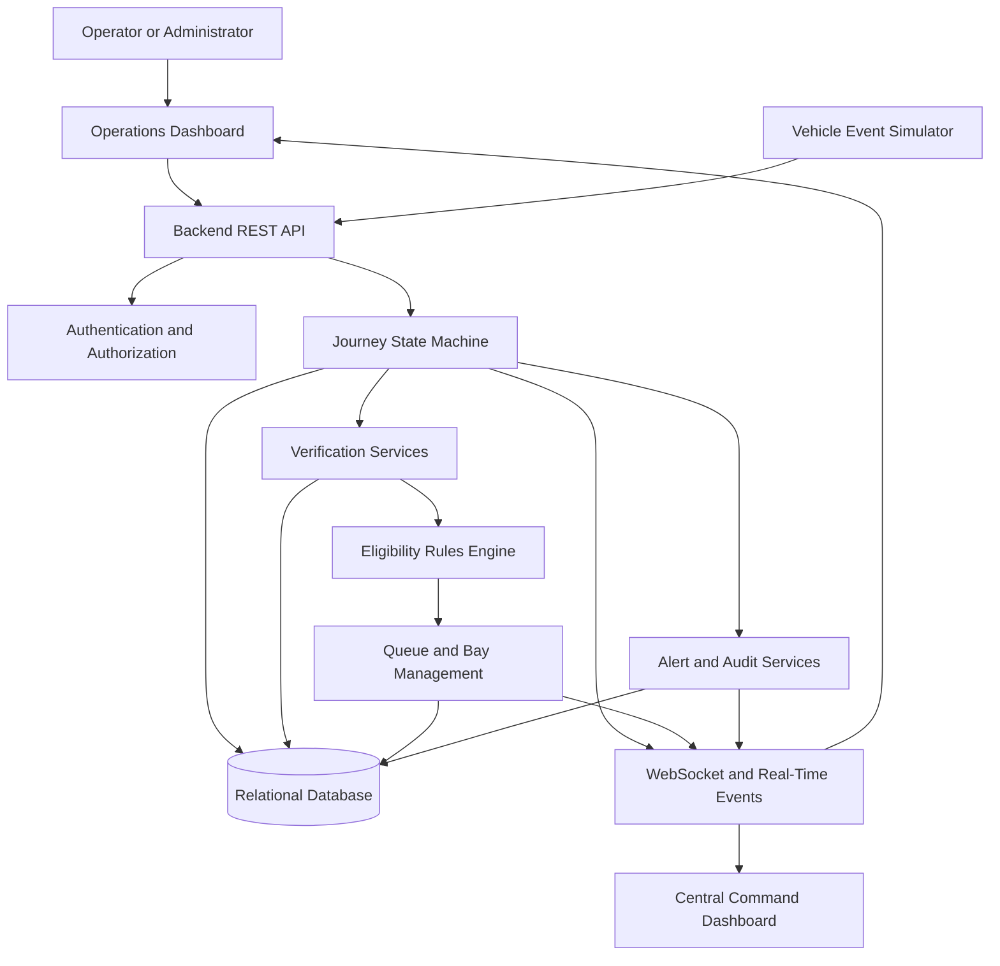

# Smart Vehicle Detection

## Smart Vehicle Compliance & Journey Management Platform

A full-stack vehicle operations platform designed to manage vehicle entry, identification, compliance verification, eligibility decisions, queue management, service bay allocation, alerts, and journey tracking.

The platform aims to provide a centralized system for monitoring vehicle movements, identifying compliance issues, and maintaining historical records of operational activities.

## Table of Contents

- Overview
- Problem Statement
- Key Features
- Vehicle Journey Workflow
- System Architecture
- Technology Stack
- Project Structure
- Getting Started
- Configuration
- API Documentation
- Security
- Testing
- Future Enhancements
- Author

## Overview

Smart Vehicle Detection is designed to digitize and streamline vehicle operations across multiple operational sites.

The system is intended to simulate vehicle identification through camera events, verify vehicle registration and compliance information, determine eligibility, and track each vehicle's journey from entry to exit.

It also provides a foundation for alerts, service bay management, audit logging, historical reporting, and centralized monitoring.

## Problem Statement

Traditional vehicle operations may depend on manual verification, disconnected systems, and limited visibility into queues, service resources, and compliance issues.

These challenges can lead to:

- Delays during vehicle entry and verification.
- Difficulty identifying non-compliant vehicles.
- Inefficient queue and service bay allocation.
- Limited visibility into ongoing vehicle journeys.
- Delayed detection of camera or external service failures.
- Incomplete operational history and audit records.

Smart Vehicle Detection aims to address these challenges through backend business logic, structured vehicle journeys, operational monitoring, and event tracking.

## Key Features

### 1. Vehicle Identification

- Simulate vehicle entry events from cameras or edge devices.
- Capture vehicle registration numbers and detection timestamps.
- Record identification confidence.
- Prevent duplicate detections from creating duplicate journeys.

### 2. Vehicle Verification

- Simulate vehicle registration and identity checks.
- Simulate vehicle certification and compliance checks.
- Record verification results and their sources.
- Handle invalid vehicles, expired certifications, timeouts, and unavailable services.

### 3. Eligibility Decision Engine

Evaluate verification results through backend business rules.

| Decision | Intended Behaviour |
|---|---|
| ELIGIBLE | Allow the vehicle to proceed |
| DUE SOON | Allow progression with a warning |
| NOT ELIGIBLE | Place the vehicle on hold and generate an alert |
| VERIFICATION FAILED | Require manual review |
| SOURCE UNAVAILABLE | Apply the configured fallback and flag re-verification |

### 4. Queue Management

- Maintain a queue for each site.
- Display queue position and waiting time.
- Prevent vehicles on hold from entering the normal queue.
- Update queue information as vehicle states change.

### 5. Service Bay Management

- Track bay availability and occupancy.
- Support AVAILABLE, RESERVED, OCCUPIED, BLOCKED, and MAINTENANCE states.
- Assign available bays to eligible vehicles.
- Record service start and completion.
- Release bays after service completion.
- Calculate resource utilisation.

### 6. Alerts and Monitoring

Potential operational alerts include:

- Non-eligible vehicles.
- Failed verification checks.
- External service outages.
- Camera disconnections.
- Excessive queue length or waiting time.
- Unavailable service resources.
- Unexpected system errors.

Alerts should support OPEN, ACKNOWLEDGED, and RESOLVED states.

### 7. Vehicle Journey Tracking

Maintain a chronological record of vehicle movement, including entry, identification, verification, eligibility, queue placement, bay assignment, service activity, and exit.

### 8. Multi-Site Command Centre

The platform is designed to support centralized monitoring of multiple sites, including vehicle activity, site availability, queue lengths, active alerts, turnaround time, and resource utilisation.

### 9. Authentication and Role-Based Access Control

The intended role model includes:

- **Operator:** Daily site operations and alerts.
- **Site Manager:** Site management and authorised overrides.
- **Regional Manager:** Multi-site monitoring and analytics.
- **Auditor:** Read-only access to historical records and reports.
- **Admin:** User, site, and system configuration management.

Permissions should be enforced by the backend, not only by hiding frontend controls.

### 10. Audit Trail

Record important operational actions with timestamps, user information, related vehicles, previous and new states, and reasons for authorised overrides.

## Vehicle Journey Workflow

The intended vehicle journey follows this sequence:

Entry → Identification → Verification → Eligibility Decision → Queue → Bay Assignment → Service → Completion → Exit

If verification fails or a vehicle is not eligible, the system should place it on hold and generate an alert for operator review.

### Workflow Diagram



## System Architecture

The intended architecture separates the user interface, backend business logic, persistent storage, and real-time event delivery.



Note: This diagram represents the intended logical architecture. Update it if the implemented architecture differs from this design.

## Technology Stack

The repository contains a Java-based backend structure and Maven project configuration. Confirm the exact dependencies in `pom.xml` before finalising this section.

| Component | Technology |
|---|---|
| Backend | Java |
| Backend Framework | Spring Boot, if configured |
| API Communication | REST APIs and JSON |
| Persistence | Jakarta Persistence / JPA |
| Database | Configured relational database |
| Build Tool | Maven |
| Real-Time Communication | WebSocket, if implemented |
| Authentication | Authentication and role-based access control |
| Version Control | Git and GitHub |

## Project Structure

The current repository includes a Maven project and a Java package under `com.abhinav.smartvehicledetection`.

```text
SmartVehicleDetection/
├── .mvn/
├── src/
│   └── main/
│       └── java/
│           └── com/
│               └── abhinav/
│                   └── smartvehicledetection/
│                       ├── config/
│                       ├── controller/
│                       ├── dto/
│                       ├── entity/
│                       └── ...
├── pom.xml
├── mvnw
├── mvnw.cmd
└── README.md
```

Additional packages and files may exist in the repository. Update this structure as the implementation develops.
## Getting Started

### Prerequisites

Install the following tools:

- Java Development Kit compatible with the version specified in `pom.xml`.
- Git.
- IntelliJ IDEA or another Java IDE.
- Maven, or use the included Maven Wrapper.
- A database supported by the project configuration.

### 1. Clone the Repository

```bash
git clone https://github.com/Iamabhipandat/SmartVehicleDetection.git
cd SmartVehicleDetection
```

### 2. Open the Project

Open the cloned folder in IntelliJ IDEA and allow Maven to import the project and resolve dependencies.

### 3. Configure the Database

Create the required database and configure its connection details in your local application configuration.

Ensure that the database server is running before starting the application.

### 4. Build the Application

On Windows PowerShell, run:

```powershell
.\mvnw.cmd clean package
```

If the Maven Wrapper is unavailable, use an installed Maven distribution:

```bash
mvn clean package
```

### 5. Run the Backend

On Windows PowerShell:

```powershell
.\mvnw.cmd spring-boot:run
```

Alternatively, run the main Spring Boot application class directly from IntelliJ IDEA.

The server port and base URL depend on the application configuration.

## Configuration

Use environment variables or a local configuration file for environment-specific settings.

Example environment variable names:

```env
SPRING_DATASOURCE_URL=jdbc:your_database_url
SPRING_DATASOURCE_USERNAME=your_database_username
SPRING_DATASOURCE_PASSWORD=your_database_password
JWT_SECRET=replace_with_a_secure_secret
```

These names are illustrative. Ensure that the application is configured to read the corresponding variables.

For local development:

1. Configure the database connection.
2. Set required secrets outside version control.
3. Confirm that the database schema and migrations are ready.
4. Start the backend.
5. Test the available endpoints using Postman or another API client.

Never commit real credentials. Provide a sanitised `.env.example` or equivalent configuration template instead.

## API Documentation

The platform is intended to expose versioned REST endpoints for vehicle operations.

Example endpoint categories include:

| Endpoint | Purpose |
|---|---|
| `POST /api/v1/events/vehicle-entry` | Ingest a simulated vehicle entry event |
| Vehicle lookup endpoint | Retrieve vehicle details |
| Journey endpoint | Retrieve journey state and history |
| Verification endpoint | Execute or retrieve verification checks |
| Queue endpoint | View site queue information |
| Bay endpoint | View bay availability and assignments |
| Alerts endpoint | View and manage operational alerts |
| Dashboard endpoint | Retrieve operational KPIs |
| Audit endpoint | Query historical audit records |
| Authentication endpoints | Authenticate users and manage access |

These are documentation targets, not confirmation that every route is implemented. Replace generic endpoint descriptions with actual HTTP methods, paths, request examples, and responses after verifying the backend controllers.

API documentation can be provided through OpenAPI/Swagger. A Postman or Bruno collection can also be included for testing.

## Security

Security considerations include:

- Backend-enforced role-based authorisation.
- Input validation for incoming vehicle events.
- Secure password handling.
- Protected API endpoints.
- Environment-based secret management.
- Duplicate event detection and safe state transitions.
- Auditing of authorised overrides.
- Meaningful error responses without exposing internal implementation details.

## Database Design

The relational database may include the following entities, depending on the implemented schema:

- Users
- Roles
- Sites
- Cameras
- Vehicles
- Journeys
- Journey Events
- Verification Results
- Alerts
- Queues
- Bays
- Service Sessions
- Audit Logs

Relationships, constraints, and indexes should support vehicle lookup, site filtering, timestamps, and journey status.

Add an ER diagram based on the actual entities and their relationships to document the implemented database design.
## Testing

The following scenarios should be covered as the implementation matures:

- Successful vehicle entry and exit.
- Eligible and non-eligible vehicles.
- Expired certification and missing vehicle records.
- External verification service failures.
- Duplicate vehicle entry events.
- Invalid journey state transitions.
- Queue overload and unavailable bays.
- Unauthorized operator actions.
- Alert acknowledgement and resolution.
- Real-time connection loss and recovery.
- Multiple sites and concurrent events.

Run the available automated tests with:

```powershell
.\mvnw.cmd test
```

Document the actual test cases, expected results, and execution status as testing is implemented.

## Performance and Reliability

The system is intended to process vehicle events reliably and maintain consistent journey records.

Important reliability considerations include:

- Duplicate event prevention.
- Validation of journey state transitions.
- Handling unavailable external verification services.
- Recovery from real-time connection interruptions.
- Safe handling of concurrent vehicle events.
- Database constraints and transaction management.
- Appropriate logging and error handling.

The hiring assignment specifies a target of at least 20 vehicle events per minute. Validate this through performance testing before reporting measured results.

## Future Enhancements

Potential improvements include:

- Real automatic number plate recognition integration.
- Live camera streaming.
- WebSocket-based dashboard updates.
- Configurable eligibility rules.
- Advanced queue and bay allocation.
- Multi-site analytics and reporting.
- Event replay and missed-event recovery.
- Docker-based deployment and CI/CD.
- Monitoring, structured logs, and performance testing.
- CSV export and richer historical reports.
- Automated API and integration tests.

## Deployment

The application can be prepared for deployment after configuring its database, environment variables, and runtime requirements.

Recommended deployment documentation includes:

- Backend hosting instructions.
- Database provisioning and migrations.
- Environment variable configuration.
- Frontend deployment, if applicable.
- API base URL configuration.
- Health checks and error monitoring.
- Build and deployment commands.

Add the live application URL here once a working deployment is available.

**Live Application:** To be added.

## Project Documentation

The following resources can be added to the repository as the project progresses:

- System architecture diagram.
- Entity Relationship Diagram (ERD).
- API documentation.
- Postman or Bruno collection.
- `.env.example` configuration template.
- Event simulator or sample seed data.
- Automated test documentation.
- Demo video demonstrating the complete vehicle journey.

## Design Decisions

The project is designed around a structured vehicle journey and backend business rules rather than arbitrary frontend status changes.

An event-oriented approach helps maintain a chronological operational history and provides a foundation for real-time dashboard updates.

A relational database is suitable for maintaining relationships among vehicles, journeys, sites, service bays, verification records, alerts, and audit logs.

For a larger deployment, the architecture could evolve to include message queues, caching, horizontally scaled API services, and distributed real-time event delivery.

These are architectural directions and should be distinguished from features already implemented.

## Author

**Abhinav Tiwari**

GitHub: [@Iamabhipandat](https://github.com/Iamabhipandat)

Project Repository: [SmartVehicleDetection](https://github.com/Iamabhipandat/SmartVehicleDetection)

## Acknowledgements

Developed in the context of a Full Stack Developer Hiring Assignment focused on vehicle compliance, journey management, real-time operational monitoring, and reliable backend architecture.

---

*This README should be updated as implementation progresses so that setup instructions, API documentation, architecture diagrams, and feature descriptions accurately reflect the current repository.*


